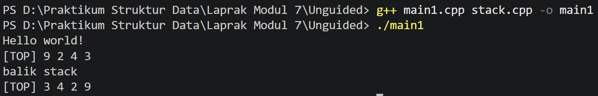
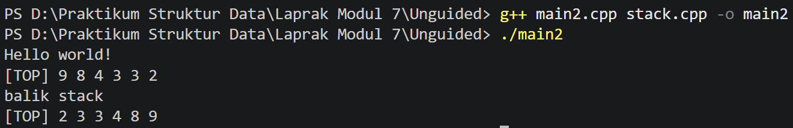
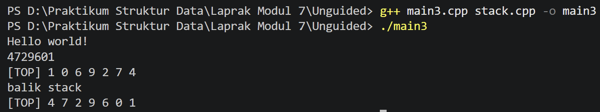

# <h1 align="center">LAPORAN PRAKTIKUM MODUL 7 - STACK</h1>
<h3 align="center">HENDA SOMANTRI PRAJA - 109082500066</h3>

## Dasar Teori
Stack atau yang biasa disebut tumpukan merupakan struktur data linier yang bekerja dengan prinsip Last In, First Out (LIFO). Artinya, data yang terakhir kali dimasukkan ke dalam tumpukan akan menjadi elemen pertama yang keluar atau diakses [1]. Berbeda dengan struktur data lain yang bebas diakses dari bagian mana saja, seluruh proses penyimpanan dan pengambilan data pada stack diatur secara ketat dan berpusat hanya pada satu ujung saja, yaitu posisi Top (puncak) [2].

### A. Konsep Dasar Stack dan Media Penyimpanan<br/>

#### 1. Karakteristik dan Prinsip LIFO 
Cara kerja stack mirip seperti tumpukan objek di dunia nyata, di mana kita hanya bisa menaruh atau mengambil barang paling atas. Dalam implementasinya, kondisi stack kosong ditandai dengan posisi Top yang berada di titik awal (biasanya bernilai 0 atau nil), sedangkan kondisi overflow terjadi saat data yang dimasukkan melebihi kapasitas maksimum yang telah disediakan [1, 2].
#### 2. Representasi Tabel (Array) dan Pointer (Linked List)
Dalam praktiknya menggunakan C++, stack umumnya direalisasikan melalui dua cara: menggunakan tabel (array statis) yang ukurannya tetap, atau menggunakan pointer (linked list) yang memorinya dialokasikan secara dinamis [1]. Pendekatan array lebih sederhana karena mengandalkan indeks, sementara pointer jauh lebih fleksibel dalam hal pengelolaan memori selama kapasitas komputer masih mencukupi [1, 2].

### B. Operasi Dasar pada Stack <br/>

#### 1. Operasi Penyisipan (Push)
Push adalah prosedur dasar untuk menambahkan data baru ke dalam stack [1]. Pada array, langkah ini dilakukan dengan menggeser posisi Top ke atas terlebih dahulu sebelum menempatkan data baru. Sementara pada pointer, simpul baru dihubungkan langsung ke elemen Top yang lama lalu posisinya diperbarui [1, 2].
#### 2. Operasi Pengambilan (Pop)
Sebaliknya, pop berfungsi untuk mengambil sekaligus menghapus data yang ada di posisi Top [1]. Sebelum operasi ini dijalankan, sistem harus memastikan stack tidak dalam kondisi kosong (underflow), di mana nilai teratas disalin ke variabel penampung lalu posisi Top diturunkan [2].
#### 3. Fungsi Pendukung (CreateStack, IsEmpty, PrintInfo)
Selain operasi utama di atas, pengoperasian stack juga memerlukan fungsi pendukung seperti createStack untuk menginisialisasi tumpukan baru, isEmpty untuk mengecek apakah tumpukan kosong, serta printInfo guna menampilkan seluruh isi data dari posisi Top ke bawah [1, 2].

## Guided (Contoh Soal)

### 1. Guided 1

### 1.1 stack.h

```C++
/* file : stack.h
   contoh ADT stack dengan representasi tabel */
#ifndef STACK_H_INCLUDED
#define STACK_H_INCLUDED

#include <iostream>
using namespace std;

struct infotype {
    char nim[20];
    char nama[20];
};
struct Stack {
    infotype info[10];
    int Top;
};

/* prototype */
/******** pengecekan apakah Stack kosong *********/
int isEmpty(Stack S);
/* mengembalikan nilai 0 jika stack kosong */

/******** pembuatan Stack ********/
void createStack(Stack &S);
/* I.S. sembarang
   F.S. terbentuk stack dengan Top=0 */

/******** penambahan elemen pada Stack ********/
void push(Stack &S, infotype X);
/* I.S. Stack mungkin kosong
   F.S. menambahkan elemen pada stack dengan nilai X, TOP=TOP+1 */

/******** penghapusan elemen pada Stack ********/
void pop(Stack &S, infotype &X);
/* I.S. stack tidak kosong
   F.S. nilai info pada indeks TOP disimpan pada X, kemudian TOP=TOP-1 */

/******** proses semua elemen Stack *********/
void viewStack(Stack S);
/* I.S. stack mungkin kosong
   F.S. jika stack tidak kosong menampilkan semua info yang ada pada stack */
#endif // STACK_H_INCLUDED
```

### 1.2 stack.cpp

```C++
#include "stack.h"

int isEmpty(Stack S) {
    /* Top = 0 berarti kosong, sesuai komentar di stack.h dikembalikan 0 */
    if (S.Top == 0) {
        return 0;
    } else {
        return 1;
    }
}

void createStack(Stack &S) {
    S.Top = 0;
}

void push(Stack &S, infotype X) {
    if (S.Top < 10) {
        S.Top = S.Top + 1;
        S.info[S.Top - 1] = X;   /* Top 1..10 dipetakan ke indeks array 0..9 */
    } else {
        cout << "Stack penuh, data tidak bisa ditambahkan" << endl;
    }
}

void pop(Stack &S, infotype &X) {
    if (isEmpty(S) != 0) {
        X = S.info[S.Top - 1];
        S.Top = S.Top - 1;
    } else {
        cout << "Stack kosong, tidak ada data yang bisa diambil" << endl;
    }
}

void viewStack(Stack S) {
    if (isEmpty(S) == 0) {
        cout << "Stack kosong" << endl;
    } else {
        cout << "Isi stack (dari TOP):" << endl;
        for (int i = S.Top; i >= 1; i--) {
            cout << i << ". " << S.info[i - 1].nim << " - "
                 << S.info[i - 1].nama << endl;
        }
    }
}
```

### 1.3 main.cpp

```C++
#include "stack.h"
#include <iostream>
#include <cstring>

using namespace std;

int main() {
    Stack S;
    infotype data, hasil;

    createStack(S);
    cout << "Stack baru dibuat, Top = " << S.Top << endl;
    viewStack(S);

    cout << endl << "--- Push 3 data ---" << endl;
    strcpy(data.nim, "103112400001");
    strcpy(data.nama, "Andi");
    push(S, data);

    strcpy(data.nim, "103112400002");
    strcpy(data.nama, "Budi");
    push(S, data);

    strcpy(data.nim, "103112400003");
    strcpy(data.nama, "Citra");
    push(S, data);
    viewStack(S);

    cout << endl << "--- Pop 1 data ---" << endl;
    pop(S, hasil);
    cout << "Data yang diambil: " << hasil.nim << " - " << hasil.nama << endl;
    viewStack(S);

    cout << endl << "--- Pop sampai kosong ---" << endl;
    pop(S, hasil);
    pop(S, hasil);
    pop(S, hasil);
    viewStack(S);

    return 0;
}
```

### Penjelasan
Program diawali dengan file stack.h yang bertindak sebagai berkas header untuk mendefinisikan kerangka dasar struktur data Stack. Di dalam file ini, dibentuk tipe data bentukan infotype yang menyimpan atribut data mahasiswa berupa NIM dan nama, serta struktur Stack yang menampung array berkapasitas maksimum 10 elemen dan variabel Top sebagai penunjuk posisi puncak. Selain itu, bagian ini juga memuat daftar purwarupa (prototype) fungsi dan prosedur penting seperti createStack, isEmpty, push, pop, dan viewStack yang menjadi standar pengoperasian tumpukan.

Selanjutnya, seluruh kerangka fungsi tersebut dijabarkan secara rinci ke dalam file implementasi stack.cpp. Pada file ini, prosedur createStack menginisialisasi tumpukan agar bermula dari nilai Top = 0, sementara fungsi isEmpty bertugas mendeteksi status kekosongan tumpukan. Operasi push dirancang untuk menambahkan data baru ke posisi atas dengan terlebih dahulu memastikan kapasitas tabel belum penuh, sedangkan operasi pop mengambil dan menghapus data teratas. Terakhir, prosedur viewStack menampilkan keseluruhan isi tumpukan secara berurutan mulai dari posisi Top paling atas turun ke bawah sesuai sifat Last In, First Out (LIFO).

Sebagai bagian akhir dari pengujian program, file main.cpp berfungsi untuk mengeksekusi seluruh logika stack yang telah dibuat pada library. Di dalam fungsi utama ini, program melakukan inisialisasi awal tumpukan, dilanjutkan dengan memasukkan tiga data mahasiswa secara berurutan di mana data terakhir akan menempati posisi puncak. Pengujian kemudian diteruskan dengan memanggil operasi pengambilan data atau pop—baik secara satuan untuk melihat data yang keluar maupun secara beruntun sampai tumpukan kembali kosong untuk memastikan bahwa seluruh mekanisme penyimpanan berbasis array ini berjalan dengan suskes.


## Unguided (Soal Latihan)

### 1. Unguided 1

### 1.1 stack.h
Buatlah ADT Stack menggunakan ARRAY sebagai berikut di dalam file "stack.h"

```C++
/* file : stack.h
   ADT Stack dengan representasi array */
#ifndef STACK_H_INCLUDED
#define STACK_H_INCLUDED

#include <iostream>
using namespace std;

typedef int infotype;

struct Stack {
    infotype info[20];
    int top;
};

/* Prototipe Soal 1 */
void createStack(Stack &S);
void push(Stack &S, infotype x);
infotype pop(Stack &S);
void printInfo(Stack S);
void balikStack(Stack &S);

/* Prototipe Soal 2 */
void pushAscending(Stack &S, int x);

/* Prototipe Soal 3 */
void getInputStream(Stack &S);

#endif // STACK_H_INCLUDED
```

### 1.2 stack.cpp
Buatlah implementasi ADT Stack menggunakan Array pada file "stack.cpp"

```C++
#include "stack.h"

/* Implementasi Soal 1: Menampilkan daftar stack */
void createStack(Stack &S) {
    S.top = 0;
}

void push(Stack &S, infotype x) {
    if (S.top < 20) {
        S.top = S.top + 1;
        S.info[S.top - 1] = x;
    } else {
        cout << "Stack penuh" << endl;
    }
}

infotype pop(Stack &S) {
    infotype x = -1;
    if (S.top > 0) {
        x = S.info[S.top - 1];
        S.top = S.top - 1;
    } else {
        cout << "Stack kosong" << endl;
    }
    return x;
}

void printInfo(Stack S) {
    cout << "[TOP] ";
    for (int i = S.top; i >= 1; i--) {
        cout << S.info[i - 1] << " ";
    }
    cout << endl;
}

void balikStack(Stack &S) {
    Stack temp;
    createStack(temp);
    while (S.top > 0) {
        push(temp, pop(S));
    }
    S = temp;
}

/* Implementasi Soal 2: Push secara terurut membesar dari bawah ke TOP */
void pushAscending(Stack &S, int x) {
    Stack temp;
    createStack(temp);
    
    // Pindahkan elemen yang lebih besar dari x ke stack sementara
    while (S.top > 0 && S.info[S.top - 1] > x) {
        push(temp, pop(S));
    }
    
    // Masukkan x di posisi yang tepat
    push(S, x);
    
    // Kembalikan elemen dari stack sementara ke stack utama
    while (temp.top > 0) {
        push(S, pop(temp));
    }
}

/* Implementasi Soal 3: Membaca karakter satu per satu hingga tombol Enter ditekan */
void getInputStream(Stack &S) {
    char ch;
    while (cin.get(ch) && ch != '\n') {
        if (ch >= '0' && ch <= '9') {
            push(S, ch - '0');
        }
    }
}
```

### 1.3 main1.cpp
Buatlah implementasi ADT Stack menggunakan Array pada file "main.cpp"

```C++
#include "stack.h"
#include <iostream>

using namespace std;

int main() {
    cout << "Hello world!" << endl;
    Stack S;
    createStack(S);
    push(S, 3);
    push(S, 4);
    push(S, 8);
    pop(S);
    push(S, 2);
    push(S, 3);
    pop(S);
    push(S, 9);
    printInfo(S);
    cout << "balik stack" << endl;
    balikStack(S);
    printInfo(S);
    return 0;
}
```

### Output Unguided 1 :


### Penjelasan Unguided 1 
Program header stack.h berfungsi sebagai deklarasi kerangka struktur data Stack dengan menggunakan representasi array statis. Di dalamnya, tipe data elemen (infotype) didefinisikan sebagai bilangan bulat (int), sementara struktur Stack dibentuk dari sebuah array info berkapasitas maksimum 20 elemen dan variabel top sebagai penunjuk posisi puncak tumpukan. Berkas ini juga memuat seluruh daftar fungsi dan prosedur yang dikelompokkan secara terstruktur mulai dari operasi dasar untuk Soal 1, fungsi penyisipan terurut untuk Soal 2, hingga prosedur pembacaan input aliran karakter untuk Soal 3.

Program implementasi stack.cpp menjabarkan logika pemrograman secara rinci untuk seluruh fungsi/prosedur yang telah dideklarasikan pada header. Pada bagian awal, terdapat prosedur standar seperti createStack, push, pop, printInfo, dan balikStack yang mengatur mekanisme tumpukan konvensional serta proses pembalikan urutan elemen menggunakan tumpukan bantuan (temp). Selanjutnya, fungsi pushAscending diimplementasikan khusus untuk menyisipkan data secara terurut membesar dari bawah ke puncak dengan memindahkan sementara elemen yang lebih besar ke tumpukan lain. Terakhir, fungsi getInputStream bertugas membaca karakter dari papan tik secara kontinu, menyaring karakter berupa angka, lalu mengubahnya menjadi nilai numerik sebelum dimasukkan ke dalam stack.

Program utama main1.cpp untuk menguji operasi dasar dan fitur pembalikan urutan pada Soal 1. Di dalam fungsi main, program mengawali eksekusi dengan membentuk tumpukan kosong, lalu melakukan beberapa kali operasi penambahan (push) dan penghapusan (pop) nilai integer secara bergantian sesuai skenario modul. Setelah kondisi akhir tumpukan dicetak ke layar melalui prosedur printInfo, program kemudian memanggil fungsi balikStack untuk membalik posisi seluruh elemen dari atas ke bawah dan menampilkan kembali hasilnya guna memastikan logika dasar tumpukan berjalan dengan semestinya.

### 2. Unguided 2
Tambahkan prosedur pushAscending(in/out S : Stack, in x : integer)

### 2.1 stack.h

```C++
/* file : stack.h
   ADT Stack dengan representasi array */
#ifndef STACK_H_INCLUDED
#define STACK_H_INCLUDED

#include <iostream>
using namespace std;

typedef int infotype;

struct Stack {
    infotype info[20];
    int top;
};

/* Prototipe Soal 1 */
void createStack(Stack &S);
void push(Stack &S, infotype x);
infotype pop(Stack &S);
void printInfo(Stack S);
void balikStack(Stack &S);

/* Prototipe Soal 2 */
void pushAscending(Stack &S, int x);

/* Prototipe Soal 3 */
void getInputStream(Stack &S);

#endif // STACK_H_INCLUDED
```

### 2.2 stack.cpp

```C++
#include "stack.h"

/* Implementasi Soal 1: Menampilkan daftar stack */
void createStack(Stack &S) {
    S.top = 0;
}

void push(Stack &S, infotype x) {
    if (S.top < 20) {
        S.top = S.top + 1;
        S.info[S.top - 1] = x;
    } else {
        cout << "Stack penuh" << endl;
    }
}

infotype pop(Stack &S) {
    infotype x = -1;
    if (S.top > 0) {
        x = S.info[S.top - 1];
        S.top = S.top - 1;
    } else {
        cout << "Stack kosong" << endl;
    }
    return x;
}

void printInfo(Stack S) {
    cout << "[TOP] ";
    for (int i = S.top; i >= 1; i--) {
        cout << S.info[i - 1] << " ";
    }
    cout << endl;
}

void balikStack(Stack &S) {
    Stack temp;
    createStack(temp);
    while (S.top > 0) {
        push(temp, pop(S));
    }
    S = temp;
}

/* Implementasi Soal 2: Push secara terurut membesar dari bawah ke TOP */
void pushAscending(Stack &S, int x) {
    Stack temp;
    createStack(temp);
    
    // Pindahkan elemen yang lebih besar dari x ke stack sementara
    while (S.top > 0 && S.info[S.top - 1] > x) {
        push(temp, pop(S));
    }
    
    // Masukkan x di posisi yang tepat
    push(S, x);
    
    // Kembalikan elemen dari stack sementara ke stack utama
    while (temp.top > 0) {
        push(S, pop(temp));
    }
}

/* Implementasi Soal 3: Membaca karakter satu per satu hingga tombol Enter ditekan */
void getInputStream(Stack &S) {
    char ch;
    while (cin.get(ch) && ch != '\n') {
        if (ch >= '0' && ch <= '9') {
            push(S, ch - '0');
        }
    }
}
```

### 2.3 main2.cpp

```C++
#include "stack.h"
#include <iostream>

using namespace std;

int main() {
    cout << "Hello world!" << endl;
    Stack S;
    createStack(S);
    pushAscending(S, 3);
    pushAscending(S, 4);
    pushAscending(S, 8);
    pushAscending(S, 2);
    pushAscending(S, 3);
    pushAscending(S, 9);
    printInfo(S);
    cout << "balik stack" << endl;
    balikStack(S);
    printInfo(S);
    return 0;
}
```

### Output Unguided 2 :


### Penjelasan Unguided 2
Program header stack.h berfungsi sebagai deklarasi kerangka struktur data Stack dengan menggunakan representasi array statis. Di dalamnya, tipe data elemen (infotype) didefinisikan sebagai bilangan bulat (int), sementara struktur Stack dibentuk dari sebuah array info berkapasitas maksimum 20 elemen dan variabel top sebagai penunjuk posisi puncak tumpukan. Berkas ini juga memuat seluruh daftar fungsi dan prosedur yang dikelompokkan secara terstruktur mulai dari operasi dasar untuk Soal 1, fungsi penyisipan terurut untuk Soal 2, hingga prosedur pembacaan input aliran karakter untuk Soal 3.

Program implementasi stack.cpp menjabarkan logika pemrograman secara rinci untuk seluruh fungsi/prosedur yang telah dideklarasikan pada header. Pada bagian awal, terdapat prosedur standar seperti createStack, push, pop, printInfo, dan balikStack yang mengatur mekanisme tumpukan konvensional serta proses pembalikan urutan elemen menggunakan tumpukan bantuan (temp). Selanjutnya, fungsi pushAscending diimplementasikan khusus untuk menyisipkan data secara terurut membesar dari bawah ke puncak dengan memindahkan sementara elemen yang lebih besar ke tumpukan lain. Terakhir, fungsi getInputStream bertugas membaca karakter dari papan tik secara kontinu, menyaring karakter berupa angka, lalu mengubahnya menjadi nilai numerik sebelum dimasukkan ke dalam stack.

Program utama main2.cpp digunakan sebagai media pengujian untuk mengevaluasi fungsi pushAscending pada Soal 2. Melalui fungsi utama ini, sejumlah nilai dimasukkan ke dalam tumpukan menggunakan prosedur penyisipan terurut tersebut, sehingga setiap data baru secara otomatis langsung menempati posisi yang sesuai dengan besar nilainya dari dasar hingga ke posisi top. Setelah seluruh elemen selesai dimasukkan dan dicetak, program juga menguji fungsi balikStack untuk melihat bagaimana struktur data tumpukan terurut tersebut berubah setelah urutan elemennya dibalik.


### 3. Unguided 3
Tambahkan prosedur getInputStream(in/out S : Stack). Prosedur akan terus membaca dan menerima input user dan memasukkan setiap input ke dalam stack hingga user menekan tombol enter. Contoh: gunakan cin.get() untuk mendapatkan inputan user.

### 3.1 stack.h

```C++
/* file : stack.h
   ADT Stack dengan representasi array */
#ifndef STACK_H_INCLUDED
#define STACK_H_INCLUDED

#include <iostream>
using namespace std;

typedef int infotype;

struct Stack {
    infotype info[20];
    int top;
};

/* Prototipe Soal 1 */
void createStack(Stack &S);
void push(Stack &S, infotype x);
infotype pop(Stack &S);
void printInfo(Stack S);
void balikStack(Stack &S);

/* Prototipe Soal 2 */
void pushAscending(Stack &S, int x);

/* Prototipe Soal 3 */
void getInputStream(Stack &S);

#endif // STACK_H_INCLUDED
```

### 3.2 stack.cpp

```C++
#include "stack.h"

/* Implementasi Soal 1: Menampilkan daftar stack */
void createStack(Stack &S) {
    S.top = 0;
}

void push(Stack &S, infotype x) {
    if (S.top < 20) {
        S.top = S.top + 1;
        S.info[S.top - 1] = x;
    } else {
        cout << "Stack penuh" << endl;
    }
}

infotype pop(Stack &S) {
    infotype x = -1;
    if (S.top > 0) {
        x = S.info[S.top - 1];
        S.top = S.top - 1;
    } else {
        cout << "Stack kosong" << endl;
    }
    return x;
}

void printInfo(Stack S) {
    cout << "[TOP] ";
    for (int i = S.top; i >= 1; i--) {
        cout << S.info[i - 1] << " ";
    }
    cout << endl;
}

void balikStack(Stack &S) {
    Stack temp;
    createStack(temp);
    while (S.top > 0) {
        push(temp, pop(S));
    }
    S = temp;
}

/* Implementasi Soal 2: Push secara terurut membesar dari bawah ke TOP */
void pushAscending(Stack &S, int x) {
    Stack temp;
    createStack(temp);
    
    // Pindahkan elemen yang lebih besar dari x ke stack sementara
    while (S.top > 0 && S.info[S.top - 1] > x) {
        push(temp, pop(S));
    }
    
    // Masukkan x di posisi yang tepat
    push(S, x);
    
    // Kembalikan elemen dari stack sementara ke stack utama
    while (temp.top > 0) {
        push(S, pop(temp));
    }
}

/* Implementasi Soal 3: Membaca karakter satu per satu hingga tombol Enter ditekan */
void getInputStream(Stack &S) {
    char ch;
    while (cin.get(ch) && ch != '\n') {
        if (ch >= '0' && ch <= '9') {
            push(S, ch - '0');
        }
    }
}
```

### 3.3 main3.cpp

```C++
#include "stack.h"
#include <iostream>

using namespace std;

int main() {
    cout << "Hello world!" << endl;
    Stack S;
    createStack(S);
    getInputStream(S);
    printInfo(S);
    cout << "balik stack" << endl;
    balikStack(S);
    printInfo(S);
    return 0;
}
```

### Output Unguided 3 :


### Penjelasan Unguided 3
Program header stack.h berfungsi sebagai deklarasi kerangka struktur data Stack dengan menggunakan representasi array statis. Di dalamnya, tipe data elemen (infotype) didefinisikan sebagai bilangan bulat (int), sementara struktur Stack dibentuk dari sebuah array info berkapasitas maksimum 20 elemen dan variabel top sebagai penunjuk posisi puncak tumpukan. Berkas ini juga memuat seluruh daftar fungsi dan prosedur yang dikelompokkan secara terstruktur mulai dari operasi dasar untuk Soal 1, fungsi penyisipan terurut untuk Soal 2, hingga prosedur pembacaan input aliran karakter untuk Soal 3.

Program implementasi stack.cpp menjabarkan logika pemrograman secara rinci untuk seluruh fungsi/prosedur yang telah dideklarasikan pada header. Pada bagian awal, terdapat prosedur standar seperti createStack, push, pop, printInfo, dan balikStack yang mengatur mekanisme tumpukan konvensional serta proses pembalikan urutan elemen menggunakan tumpukan bantuan (temp). Selanjutnya, fungsi pushAscending diimplementasikan khusus untuk menyisipkan data secara terurut membesar dari bawah ke puncak dengan memindahkan sementara elemen yang lebih besar ke tumpukan lain. Terakhir, fungsi getInputStream bertugas membaca karakter dari papan tik secara kontinu, menyaring karakter berupa angka, lalu mengubahnya menjadi nilai numerik sebelum dimasukkan ke dalam stack.

Program utama main3.cpp berfungsi untuk menguji penerapan prosedur getInputStream pada Soal 3 yang berinteraksi langsung dengan masukan pengguna melalui konsol. Saat program berjalan, fungsi utama menginisialisasi tumpukan kosong dan memanggil fungsi input agar program siap menerima ketikan karakter atau deretan angka dari pengguna hingga tombol Enter ditekan. Karakter angka yang masuk akan otomatis disaring, dimasukkan ke dalam stack, dan dicetak ke layar, sebelum akhirnya urutan tumpukan tersebut dibalik menggunakan prosedur balikStack untuk melihat hasil susunan akhirnya.


## Kesimpulan
Berdasarkan keseluruhan rangkaian praktikum struktur data ini, dapat disimpulkan bahwa stack atau tumpukan merupakan bentuk struktur data linier yang menerapkan prinsip kerja Last In, First Out (LIFO), di mana pengelolaan elemen datanya diatur secara ketat dan berpusat hanya pada satu titik akses yaitu posisi top. Melalui penerapan representasi array statis, kestabilan program sangat bergantung pada ketelitian penanganan indeks serta validasi batas kapasitas memori untuk mencegah kesalahan seperti overflow atau underflow. Lebih lanjut, eksplorasi dari contoh program hingga latihan mandiri menunjukkan bahwa logika dasar tumpukan dapat dikembangkan secara fleksibel untuk menyelesaikan berbagai kasus kompleks, mulai dari pembalikan urutan elemen, penyisipan data terurut membesar, hingga penyaringan aliran karakter masukan pengguna, yang secara keseluruhan memperkuat pemahaman mendalam mengenai manipulasi memori dan algoritma pemrograman C++.


## Referensi
<br> [1] Setiyawan, R. D., Hermawan, D., & Abdillah, A. F. (2024). Penggunaan Struktur Data Stack dalam Pemrograman C++ dengan Pendekatan Array dan Linked List. JUTECH: Journal Education and Technology. https://www.researchgate.net/publication/387858466_PENGGUNAAN_STRUKTUR_DATA_STACK_DALAM_PEMROGRAMAN_C_DENGAN_PENDEKATAN_ARRAY_DAN_LINKED_LIST
<br> [2] ResearchGate. (2024). Introduction to Stack Data Structure and Expression Parsing. ResearchGate Academic Publication. https://www.researchgate.net/publication/385356626_Introduction_to_Stack_Data_Structure_and_Expression_Parsing